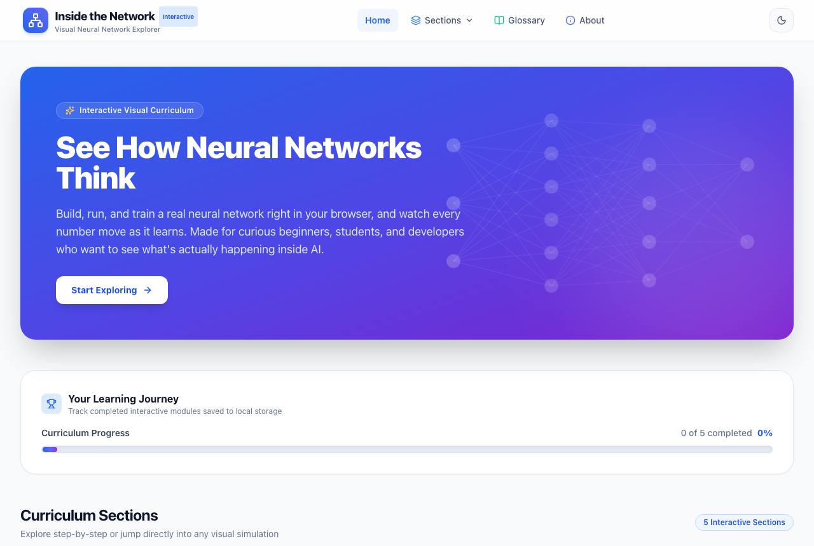
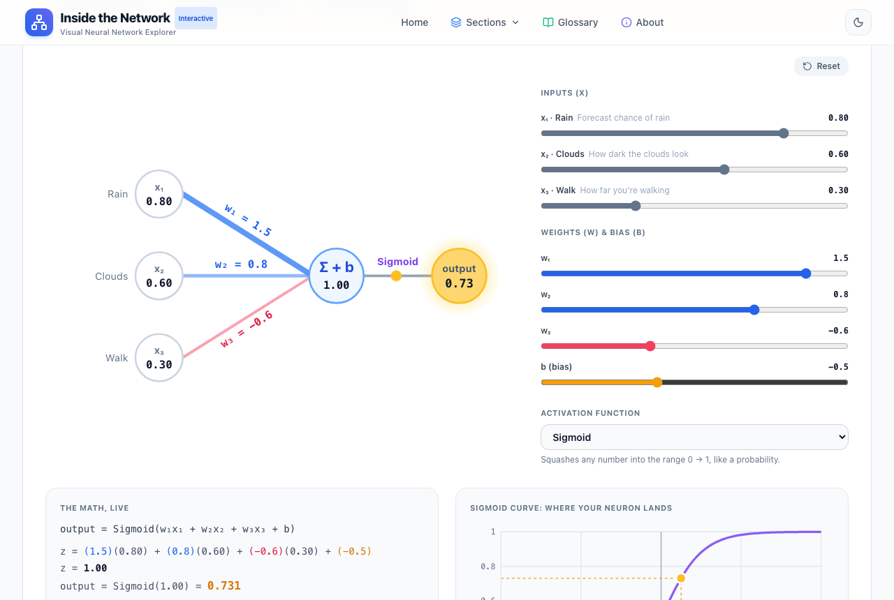
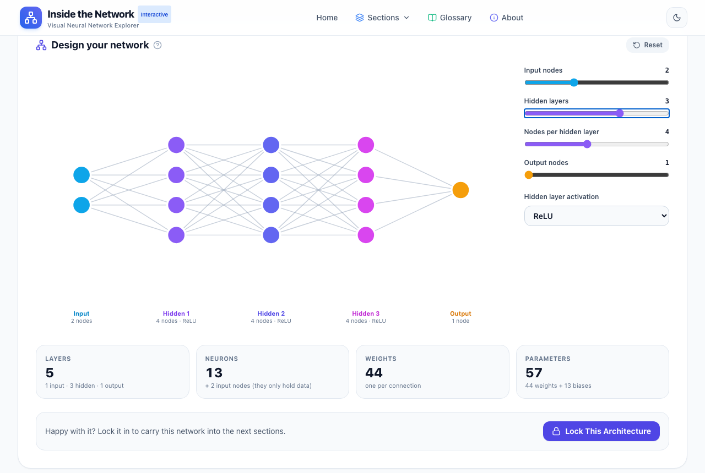
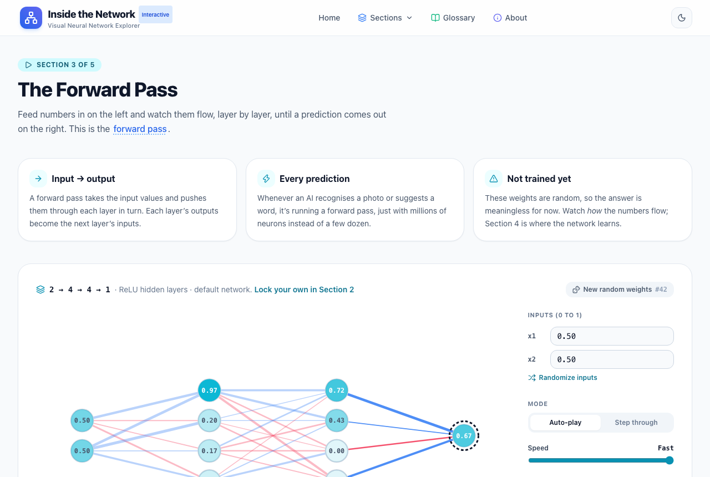
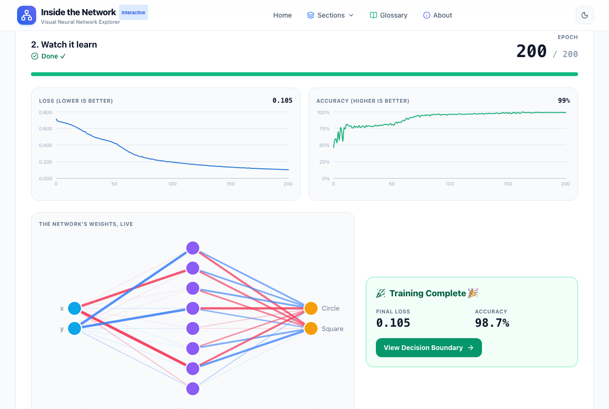
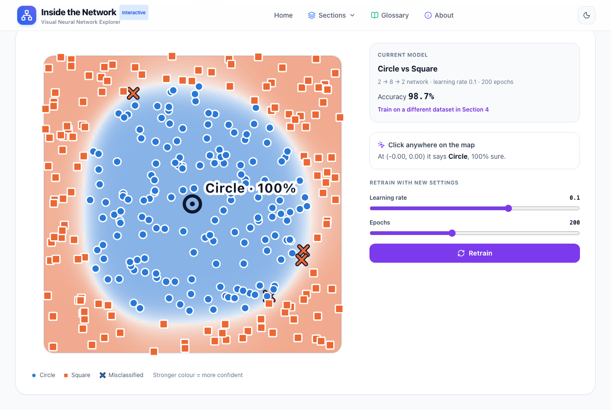

# 🧠 Inside the Network

**An interactive, visual explainer of how neural networks work.** Instead of reading about neurons, weights and training, you build a real network, run data through it, train it, and watch every number change, all in your browser.

Made for curious beginners, students and developers who want to see what's actually happening inside AI. No maths background needed: every term links to a plain-language glossary.



---

## 📚 The five sections

Each section builds on the one before, and work carries forward: the network you design in Section 2 is the one Section 3 runs, and the model you train in Section 4 is the one Section 5 explores.

| # | Section | What you do | What you learn |
| :-: | :--- | :--- | :--- |
| 1 | **What is a Neuron?** | Drag sliders for inputs, weights and bias; switch activation functions | A neuron is a weighted sum plus a bias, passed through an activation function |
| 2 | **Build the Network** | Add layers and neurons and watch the diagram rebuild live; lock in your design | Layers, full connectivity, and how quickly the number of weights grows |
| 3 | **Forward Pass** | Run inputs through your network and watch values light up layer by layer, or step through manually | How a prediction is computed, one layer's outputs feeding the next |
| 4 | **Train & Watch it Learn** | Pick a dataset, tune learning rate / epochs / hidden size, then start, pause and resume training | Loss, accuracy, epochs, and how weights change as a network learns |
| 5 | **Decision Boundary** | See what the trained network predicts across the whole plane; click anywhere to get a prediction; retrain and compare | How hidden layers let a network draw curved boundaries, and what "confidence" means |

Plus a searchable **Glossary** of AI terms, an **About** page, and progress tracking that remembers which sections you've completed.

<table>
  <tr>
    <td width="50%"><br><sub><b>1. Neuron:</b> every slider updates the output instantly</sub></td>
    <td width="50%"><br><sub><b>2. Build:</b> the diagram re-lays itself out as you change layers</sub></td>
  </tr>
  <tr>
    <td><br><sub><b>3. Forward Pass:</b> each node shows its value; edge colour and thickness show each weight</sub></td>
    <td><br><sub><b>4. Train:</b> loss, accuracy and weights update every epoch</sub></td>
  </tr>
  <tr>
    <td colspan="2"><br><sub><b>5. Decision Boundary:</b> colour = predicted class, strength = confidence; ✕ marks misclassified points</sub></td>
  </tr>
</table>

---

## 🏛️ How it works

Two independent halves that talk only over HTTP:

```text
 Browser ──► React app (Vite, :5173) ──/api/*──► FastAPI (:8000) ──► PyTorch / scikit-learn
                                       (proxied by Vite in development)
```

* **Frontend** (`frontend/`): React 19, Vite, Tailwind CSS. Section 1 does its maths in the browser, because it's cheap and the sliders need instant feedback. The network diagrams are SVG animated with Framer Motion, charts use Recharts, and d3 provides chart scales.
* **Backend** (`backend/`): FastAPI with PyTorch. It builds and runs networks (Section 3), trains them (Section 4) and evaluates them over a 100×100 grid (Section 5).
* **Training runs in a background thread.** `POST /api/train/start` returns right away. The frontend then polls `GET /api/train/status/{id}?since=N` about every 200 ms and receives only the epochs it hasn't seen yet. Each epoch is padded slightly so a run takes a few seconds and you can watch it learn.
* **One shared model.** A single `AppState` object (`backend/state.py`) holds the current run and the last finished model, which is how Section 5 knows what Section 4 trained.

### API overview

Full interactive docs, with request/response schemas and a "Try it out" button, are at **http://localhost:8000/docs** while the backend is running.

| Method | Endpoint | Used by | Purpose |
| :--- | :--- | :--- | :--- |
| GET | `/health` | all | Is the server up? |
| POST | `/api/neuron/compute` | Section 1 | One neuron's output (reference implementation of the in-browser maths) |
| POST | `/api/forward-pass/run` | Section 3 | Run inputs through a seeded network; returns every layer's values |
| GET | `/api/train/datasets/{name}` | Section 4 | The points of `xor`, `circle` or `clusters` |
| POST | `/api/train/start` | Section 4 | Start a training run in the background |
| GET | `/api/train/status/{id}?since=N` | Section 4 | Poll progress: epoch, loss, accuracy, weights |
| POST | `/api/train/pause` · `/resume` · `/reset` | Section 4 | Control the current run |
| GET | `/api/boundary/status` | Section 5 | Is there a trained model yet? |
| GET | `/api/boundary/grid` | Section 5 | Predictions and confidence over a 100×100 grid |
| POST | `/api/boundary/predict-point` | Section 5 | Classify one clicked point |
| POST | `/api/boundary/default` | Section 5 | Train a default XOR model instantly (if you skipped Section 4) |

---

## 🚀 Getting started

### Prerequisites

* **Node.js** 20.19+ or 22.12+ (required by Vite 8)
* **Python** 3.10 or newer
* **Git**

### 1. Clone

```bash
git clone <this-repo-url> inside-the-network
cd inside-the-network
```

### 2. Backend (FastAPI), in terminal 1

```bash
cd backend

# Create and activate a virtual environment
python3 -m venv venv
source venv/bin/activate          # Windows: .\venv\Scripts\activate

pip install -r requirements.txt   # PyTorch is the big one; this can take a few minutes

uvicorn main:app --reload --port 8000
```

Check it's running: http://localhost:8000/health should return `{"status": "ok", ...}`, and the API docs are at http://localhost:8000/docs.

### 3. Frontend (React + Vite), in terminal 2

```bash
cd frontend
npm install
npm run dev
```

Open **http://localhost:5173**. Keep both terminals running: Vite forwards every `/api/...` request to the backend on port 8000.

> **Backend not running?** Sections 1 and 2 still work, since they run entirely in the browser. Sections 3–5 show a "Can't reach the backend" message with the command to start it.

---

## 🧪 Tests

| Suite | Command | Where | What it covers |
| :--- | :--- | :--- | :--- |
| Backend | `python -m pytest` (in `backend/`, venv active, after `pip install -r requirements-dev.txt`) | `backend/tests/` | Every endpoint: correct numbers, shapes, 422s for bad input, training lifecycle, CORS |
| Frontend unit | `npm test` (in `frontend/`) | `frontend/src/**/*.test.js` | Pure logic: neuron maths, network layout, glossary data |
| End-to-end | `npm run test:e2e` (in `frontend/`) | `frontend/e2e/` | A real browser through every section, the full learner journey, error states, mobile layouts |

The end-to-end tests start their **own** backend (port 8765) and frontend (port 5199), so they won't interfere with dev servers you have open. The first run needs a browser: `npx playwright install chromium`.

To refresh the README screenshots after UI changes, start both dev servers and run `npm run screenshots` in `frontend/`.

---

## 🗂️ Project structure

```text
.
├── backend/                     FastAPI + PyTorch API
│   ├── main.py                  App setup: logging, CORS, routers
│   ├── state.py                 AppState: current training run + last trained model
│   ├── routers/                 One file per section (HTTP layer only)
│   │   ├── health.py
│   │   ├── neuron.py            Section 1
│   │   ├── forward_pass.py      Section 3
│   │   ├── train.py             Section 4
│   │   └── boundary.py          Section 5
│   ├── schemas/                 Pydantic request/response models (validation + /docs)
│   ├── models/network.py        ConfigurableNetwork: any layer sizes, seeded weights
│   ├── utils/
│   │   ├── trainer.py           TrainingSession: the training loop in a background thread
│   │   ├── datasets.py          XOR, Circle vs Square, Three Clusters
│   │   └── boundary.py          Grid generation and batch prediction
│   ├── tests/                   pytest + FastAPI TestClient
│   ├── requirements.txt
│   └── requirements-dev.txt     + pytest
│
├── frontend/                    React 19 + Vite + Tailwind
│   ├── src/
│   │   ├── App.jsx              Router and providers
│   │   ├── layouts/             MainLayout: header, footer, page container
│   │   ├── pages/               One page per route (the five sections, Home, Glossary, About, 404)
│   │   ├── components/          Shared UI, plus one folder per section's visualizations
│   │   │   ├── neuron/  build/  forward/  train/  boundary/
│   │   │   └── Header.jsx       Also exports SECTIONS_NAV, the single list of sections
│   │   ├── hooks/               useProgress, useArchitecture, useTraining, useBoundaryGrid
│   │   ├── context/             ThemeContext (dark/light mode)
│   │   ├── api/client.js        Every backend call, in one place
│   │   ├── utils/               Pure functions (neuron maths, network layout, …) + unit tests
│   │   └── data/glossary.js     Glossary content, shared by the Glossary page and inline tooltips
│   ├── e2e/                     Playwright end-to-end tests
│   ├── scripts/                 capture-screenshots.cjs
│   └── vite.config.js           Dev server + /api proxy
│
├── docs/screenshots/            Images used in this README
├── plan.md                      Phase-by-phase roadmap
├── lessons.md                   Software-engineering lessons learned while building this
└── CLAUDE.md                    Guidance for AI coding assistants working in this repo
```

---

## 💡 Engineering notes

This project doubles as a software-engineering learning exercise. Components and hooks open with a comment listing the design patterns they use, and [`lessons.md`](lessons.md) records the patterns and debugging lessons from each phase. A few of the main ideas:

1. **Separation of concerns.** The frontend handles visualization and interaction; the backend handles numerical work. They share nothing but an HTTP contract, validated on the server by Pydantic.
2. **Keep heavy work off the event loop.** Route handlers that use PyTorch are plain `def`, so FastAPI runs them in a worker thread, and training runs in its own background thread guarded by a lock.
3. **One source of truth.** The section list (`SECTIONS_NAV`), glossary content and network layout maths each live in one place and are reused everywhere.
4. **Empty states aren't errors.** "No model trained yet" is a normal state with its own UI and a way forward, not a red error message.
5. **Reproducible by design.** Datasets and initial weights come from fixed seeds, so what you see in a preview is exactly what the network trains on.
